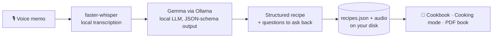

# Heirloom 🍲

**Turn a loved one's rambling voice memo into a beautiful family recipe page, 100% on your own computer, with open-source AI.**

Built for the *Hacktoberfest 2026 Weekend Challenge: Build for a Friend* (DEV). One real person, one real problem: a grandparent who cooks the best food in the family and has never written a single recipe down.

> No account. No API key. No bill. The voice, the stories and the health details of the people you love never touch a server you don't control.

<!-- Add screenshots here:


-->

---

## Table of contents

1. [What it does](#what-it-does)
2. [How it works](#how-it-works)
3. [Tech stack](#tech-stack)
4. [Quick start (local)](#quick-start-local)
5. [Configuration](#configuration)
6. [Deploy on Render](#deploy-on-render)
7. [API reference](#api-reference)
8. [Project structure](#project-structure)
9. [Design decisions](#design-decisions)
10. [Why open source matters here](#why-open-source-matters-here)
11. [Troubleshooting](#troubleshooting)
12. [Roadmap](#roadmap)
13. [License](#license)

---

## What it does

| Feature | Details |
|---|---|
| 🎙️ **Capture** | Record in the browser (live waveform), upload a voice note (WhatsApp `.opus`, `.m4a`, `.mp3`, `.wav`), or paste text |
| 🧠 **Understand** | Local Whisper transcribes; a local Gemma model turns the ramble into a structured recipe |
| 🌍 **Languages** | Write the recipe in English, Sinhala, Tamil, or the same language as the memo |
| 📖 **Recipe page** | Title, story in their words, serves/time, ingredients, steps, tips, tags, allergens |
| ❓ **Ask them next time** | Vague or missing details become questions to take back to the storyteller instead of guesses |
| 🔊 **Their voice, kept** | The original recording is saved and playable inside the recipe |
| 👩‍🍳 **Cooking mode** | One big step at a time for messy hands |
| 📚 **Cookbook** | Saved recipes as book covers; copy as text; print the whole thing as a PDF book |
| 🌓 **Design** | Warm paper theme, dark mode, responsive, works offline (system fonts, no CDN) |

## How it works



1. The browser records audio with `MediaRecorder` (or you upload a file).
2. `POST /api/transcribe` stores the audio and runs **faster-whisper** with voice-activity detection.
3. `POST /api/structure` sends the transcript to **Gemma through Ollama** with a strict JSON schema (`format` parameter), so even a small model returns valid, typed output.
4. The prompt forbids inventing amounts, times or steps. Anything vague goes to the `unclear` list as a question.
5. You review and edit the title, then save. Data lives in `data/recipes.json` and `data/audio/`.

## Tech stack

- **Backend:** Python 3.10+, FastAPI, Uvicorn, httpx
- **Speech-to-text:** [faster-whisper](https://github.com/SYSTRAN/faster-whisper) (CTranslate2, int8, runs on CPU)
- **LLM:** [Gemma](https://deepmind.google/models/gemma/) (open-weight) served by [Ollama](https://ollama.com), swappable for Llama, Qwen, etc.
- **Frontend:** plain HTML, CSS and JavaScript. No framework, no build step, no CDN.
- **Storage:** a JSON file and audio files on local disk.

## Quick start (local)

Requirements: **Python 3.10+** and **[Ollama](https://ollama.com/download)**.

### Windows (PowerShell)

```powershell
git clone https://github.com/<your-username>/heirloom-voice-recipes.git
cd heirloom-voice-recipes

python -m venv .venv
Set-ExecutionPolicy -Scope Process -ExecutionPolicy Bypass   # only if activation is blocked
.venv\Scripts\Activate.ps1

pip install -r requirements.txt
ollama pull gemma3:4b

uvicorn app.main:app --reload --port 8000
```

### macOS / Linux

```bash
git clone https://github.com/<your-username>/heirloom-voice-recipes.git
cd heirloom-voice-recipes

python -m venv .venv && source .venv/bin/activate
pip install -r requirements.txt
ollama pull gemma3:4b

uvicorn app.main:app --reload --port 8000
```

Open **http://localhost:8000**.

The first transcription downloads the Whisper model once (about 500 MB for `small`). After that everything works offline.

### Preview the UI without any AI models

```powershell
$env:HEIRLOOM_DEMO=1; uvicorn app.main:app --port 8000      # PowerShell
```
```bash
HEIRLOOM_DEMO=1 uvicorn app.main:app --port 8000            # macOS / Linux
```

Demo mode returns a canned transcript and recipe so you can click through the whole experience.

## Configuration

All configuration is through environment variables.

| Variable | Default | Description |
|---|---|---|
| `OLLAMA_MODEL` | `gemma3:4b` | Any Ollama model, e.g. `gemma3:12b`, `llama3.2`, `qwen2.5` |
| `OLLAMA_URL` | `http://localhost:11434` | Point to another machine running Ollama |
| `WHISPER_MODEL` | `small` | `tiny`, `base`, `small`, `medium`. Bigger is better for Sinhala and Tamil, but slower |
| `HEIRLOOM_DEMO` | unset | `1` returns canned responses (UI preview, hosting demo) |

Hardware guide: `gemma3:4b` + Whisper `small` run on a typical laptop CPU (expect tens of seconds per memo). A GPU makes it near-instant.

## Deploy on Render

Heirloom's web app deploys to [Render](https://render.com) easily. The AI parts need more resources than a free instance has, so there are two stages.

### Stage 1: Demo deployment (free, UI + demo mode)

Good for a public link in your DEV post. Runs in `HEIRLOOM_DEMO=1` with canned AI responses.

**Option A. Blueprint:** push this repo to GitHub, then in Render choose **New → Blueprint** and select the repo. `render.yaml` configures everything.

**Option B. Manual form:** **New → Web Service → connect the repo**, then fill in:

| Field | Value |
|---|---|
| Name | `heirloom` |
| Language | `Python 3` |
| Branch | `main` |
| Root Directory | *(leave empty)* |
| Region | closest to you |
| Build Command | `pip install -r requirements-render.txt` |
| Start Command | `uvicorn app.main:app --host 0.0.0.0 --port $PORT` |
| Instance Type | `Free` |
| Health Check Path (Advanced) | `/healthz` |

Environment variables:

| Key | Value |
|---|---|
| `HEIRLOOM_DEMO` | `1` |

Notes for the free tier: the service sleeps after inactivity (first load can take about a minute), and the disk is **ephemeral**, so saved recipes reset on every redeploy or restart. Microphone recording works because Render serves HTTPS.

### Stage 2: Real AI on Render (paid)

Run the open models on Render itself:

1. **Ollama as a Private Service** from a Docker image (`ollama/ollama`), with a **persistent disk** mounted at `/root/.ollama` and an instance with enough RAM for the model (4 GB+ for `gemma3:4b`; check Render's current plans). After the first deploy, open its shell and run `ollama pull gemma3:4b`.
2. **Heirloom web service** with:

   | Key | Value |
   |---|---|
   | `OLLAMA_URL` | the private service address, e.g. `http://ollama:11434` |
   | `OLLAMA_MODEL` | `gemma3:4b` |
   | `WHISPER_MODEL` | `base` (or `small` if RAM allows) |
   | `HEIRLOOM_DEMO` | *(remove it)* |

   Build command: `pip install -r requirements.txt` (includes faster-whisper).
3. Add a **persistent disk** to the web service mounted at `/opt/render/project/src/data` so recipes and recordings survive deploys.

> Privacy note: once hosted, audio is processed on your Render instance rather than only on your laptop. The local-first setup remains the strongest privacy story.

## API reference

| Method | Path | Body | Returns |
|---|---|---|---|
| `GET` | `/api/status` | | Ollama/Whisper availability, demo flag |
| `GET` | `/healthz` | | `{"ok": true}` |
| `POST` | `/api/transcribe` | multipart `audio` | `{transcript, language, duration, audio}` |
| `POST` | `/api/structure` | `{transcript, storyteller, output_language}` | Recipe JSON |
| `GET` | `/api/recipes` | | Saved recipes, newest first |
| `POST` | `/api/recipes` | `{recipe, storyteller, transcript, language, audio}` | Saved item |
| `DELETE` | `/api/recipes/{id}` | | `{ok: true}` |

Recipe JSON:

```json
{
  "title": "Seeya's Pol Sambol",
  "story": "…",
  "serves": "4",
  "time": "15 minutes",
  "ingredients": [{"item": "fresh grated coconut", "amount": "2 cups"}],
  "steps": ["…"],
  "tips": ["…"],
  "tags": ["Sri Lankan"],
  "allergens": ["fish (Maldive fish)"],
  "unclear": ["How much Maldive fish exactly?"]
}
```

## Project structure

```
heirloom-voice-recipes/
├── app/
│   ├── main.py              # FastAPI app and API routes
│   └── static/
│       ├── index.html       # UI
│       ├── style.css        # design system, dark mode, print styles
│       └── app.js           # recorder, pipeline, cookbook, cooking mode
├── data/                    # created at runtime: recipes.json + audio (git-ignored)
├── render.yaml              # Render blueprint (demo deployment)
├── requirements.txt         # full local install (with faster-whisper)
├── requirements-render.txt  # light install for demo hosting
├── DEV_POST.md              # draft of the DEV submission post
├── LICENSE
└── README.md
```

## Design decisions

- **Schema-constrained generation.** Ollama's `format` accepts a JSON schema, so a 4B model reliably returns parseable recipes. A `normalise()` step guarantees the shape on the way out.
- **Never invent.** The prompt forbids guessing quantities. Uncertainty becomes a question in `unclear`. This keeps the recipe honest and turns a weakness of the memo into a reason to talk to the person again.
- **Keep the voice.** The audio is stored next to the recipe, because the point is not only the instructions but hearing them say it.
- **No build step.** Vanilla JS and system fonts keep the app small, fast and fully offline.

## Why open source matters here

- **Privacy:** family voices, stories and dietary details stay on hardware you control.
- **Swappable:** change `OLLAMA_MODEL` or `WHISPER_MODEL` with one variable. Better Sinhala support next month? Switch, no code change.
- **Free and offline:** works in the kitchen with no signal and costs nothing to run, so it outlives any API pricing page.

## Troubleshooting

| Problem | Fix |
|---|---|
| `&&` or `source` errors in PowerShell | Use the Windows commands above (`.venv\Scripts\Activate.ps1`) |
| "running scripts is disabled" | `Set-ExecutionPolicy -Scope Process -ExecutionPolicy Bypass` then activate again |
| Pill shows **Ollama offline** | Start Ollama (`ollama serve`) or open the Ollama app |
| Pill shows yellow / "model not found" | `ollama pull gemma3:4b` |
| Microphone blocked | Use `http://localhost:8000` or HTTPS, and allow mic permission. Or use the Upload tab |
| First transcription is slow | The Whisper model is downloading once. Later runs are faster. Try `WHISPER_MODEL=base` |
| Poor Sinhala transcription | Use `WHISPER_MODEL=medium`, or record in clear audio close to the mic |
| Recipe quality is weak | Try a bigger model: `OLLAMA_MODEL=gemma3:12b` |

## Roadmap

- Sinhala and Tamil UI
- Import a whole WhatsApp chat export of voice notes
- Photos of the dish and of the cook
- Unit scaling and servings calculator
- Shareable read-only family cookbook link
- Fine-tune a small model on recipe structuring (Tinker / LoRA)

## License

MIT. See [LICENSE](LICENSE).

## Acknowledgements

[Ollama](https://ollama.com), [Gemma](https://deepmind.google/models/gemma/), [faster-whisper](https://github.com/SYSTRAN/faster-whisper), [FastAPI](https://fastapi.tiangolo.com), and every grandparent who says "enough" when you ask how much.
